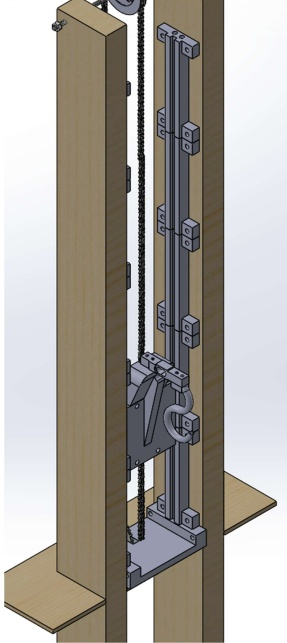
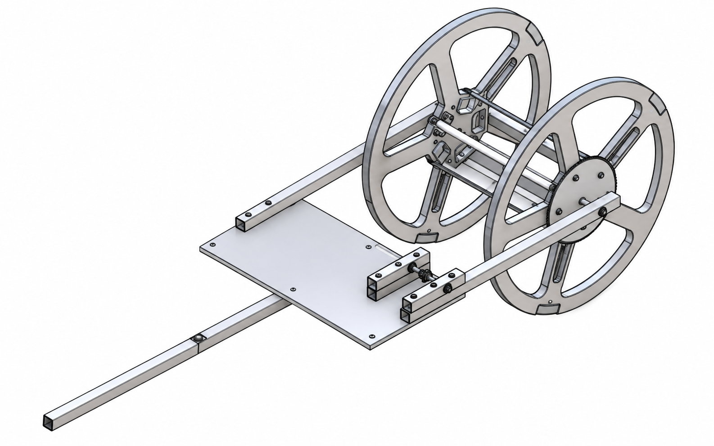
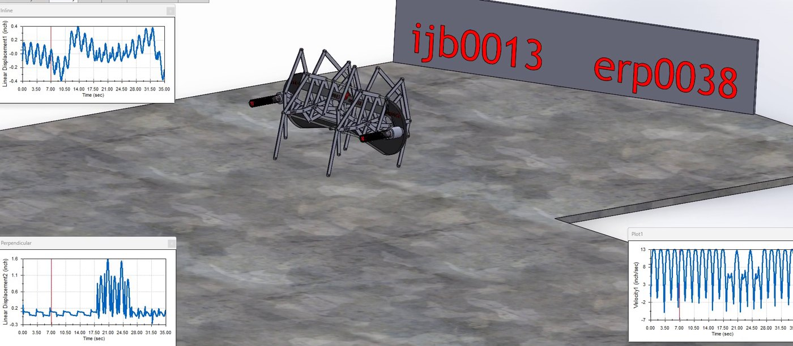
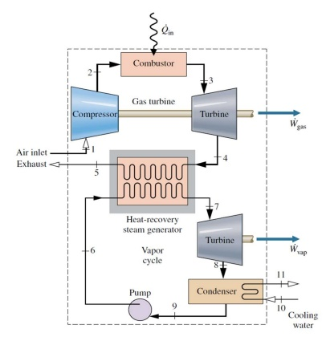

# Mechanical Engineering | College Projects

A portfolio of five collaborative engineering projects spanning mechanical design, robotics, mechatronics, controls, thermodynamics, prototyping, and technical analysis.

**Core tools and methods:** SolidWorks · MATLAB · Arduino/C++ · 3D printing · finite element analysis (FEA) · motion simulation · state-space modeling · engineering drawings.

## Featured projects

| Project | Engineering focus | Selected outcome |
| --- | --- | --- |
| [Automated IV Bag Lift and Monitoring System](projects/automated-iv-bag-lift/) | Embedded control, sensing, mechanism design, FEA | Working automatic lift prototype; ~$115 materials estimate; documented drivetrain failure analysis |
| [Drill-Powered Stair Climber](projects/drill-powered-stair-climber/) | CAD, mechanisms, manufacturing | 20-sheet drawing package; $99.45 materials list; stair-climbing motion study |
| [Klann Six-Bar Walking Robot](projects/klann-six-bar-walking-robot/) | Robotics, kinematics, dynamics | Eight-legged simulated robot; foot trajectory, speed, and motor-torque studies |
| [Rotary Inverted Pendulum](projects/rotary-inverted-pendulum-control/) | MATLAB, system modeling, feedback control | State-feedback and cascade-controller study; reference-model discrepancy documented |
| [Brayton–Rankine Power Plant](projects/brayton-rankine-power-plant/) | Thermodynamics and energy systems | 100 MW design target; ~51% reported combined-cycle thermal efficiency |

## Project gallery

[Automated IV Bag Lift and Monitoring System](projects/automated-iv-bag-lift/)

[Drill-Powered Stair Climber](projects/drill-powered-stair-climber/)

[Klann Six-Bar Walking Robot](projects/klann-six-bar-walking-robot/)

[Rotary Inverted Pendulum](projects/rotary-inverted-pendulum-control/)

[Brayton–Rankine Power Plant](projects/brayton-rankine-power-plant/)

*The schematics are original simplified illustrations, not as-built CAD drawings or verified analysis plots.*

## Projects at a glance

### Automated IV Bag Lift and Monitoring
A load-cell-driven motorized lift intended to reduce repeated overhead adjustments of IV bags. The prototype combines an Arduino Nano, HX711 load-cell amplifier, guided carriage, and mechanical drive. Testing demonstrated automatic motion and revealed a motor-to-gear coupling failure mode that informed further design refinement. [Read details](projects/automated-iv-bag-lift/)

### Drill-Powered Stair Climber
A redesign study of a drill-powered stair-climbing mechanism, combining SolidWorks CAD with a detailed drawing package, manufacturing information, bill of materials, and motion study. The project emphasizes manufacturability, feasibility, and analysis-driven iteration. [Read details](projects/drill-powered-stair-climber/)

### Klann Six-Bar Walking Robot
A kinematic and dynamic study of the Klann walking mechanism, extended to an eight-legged robot assembly. The work evaluates a walking foot path, torque demand under contact loads, and robot speed versus motor RPM to assess locomotion performance. [Read details](projects/klann-six-bar-walking-robot/)

### Rotary Inverted Pendulum
Coupled dynamics were derived using Lagrangian mechanics and analyzed in MATLAB for a rotary inverted pendulum. The project examines full-state feedback and cascaded PD control to evaluate stabilization behavior and compare simulated response to the reference model. [Read details](projects/rotary-inverted-pendulum-control/)

### Brayton–Rankine Combined-Cycle Power Plant
A conceptual natural-gas combined-cycle design that recovers turbine exhaust heat into a Rankine steam cycle. The study evaluates operating states, component selection, mass flow, environmental tradeoffs, and reported combined-cycle efficiency. [Read details](projects/brayton-rankine-power-plant/)

## Technical skills

- **Design and analysis:** SolidWorks, CAD assemblies, tolerancing, fabrication drawings, free-body diagrams, FEA, rigid-body dynamics, motion studies.
- **Programming and controls:** MATLAB, Arduino/C++, sensor calibration, transfer functions, state-space modeling, pole placement, Bode plots, root locus.
- **Thermal and power systems:** Brayton/Rankine cycles, heat recovery, thermodynamic property analysis, energy balances.
- **Engineering practice:** Concept selection, budgets/BOMs, prototyping, testing, design tradeoffs, failure analysis, and collaboration.

## About these projects

These are collaborative academic engineering projects, not independent commercial or certified designs. Descriptions reflect the shared reports and presentations and do not attribute every action to a single individual. Design targets are distinguished from measured and simulated results.

This public overview intentionally does not include full class reports, presentation slides, videos, or CAD files pending review of team permissions and any identifying or third-party material. Supporting source documents may be added later after that review.

**Related demonstration:** [Stair climber project video](https://youtu.be/po6vs3vmDWY?feature=shared).
