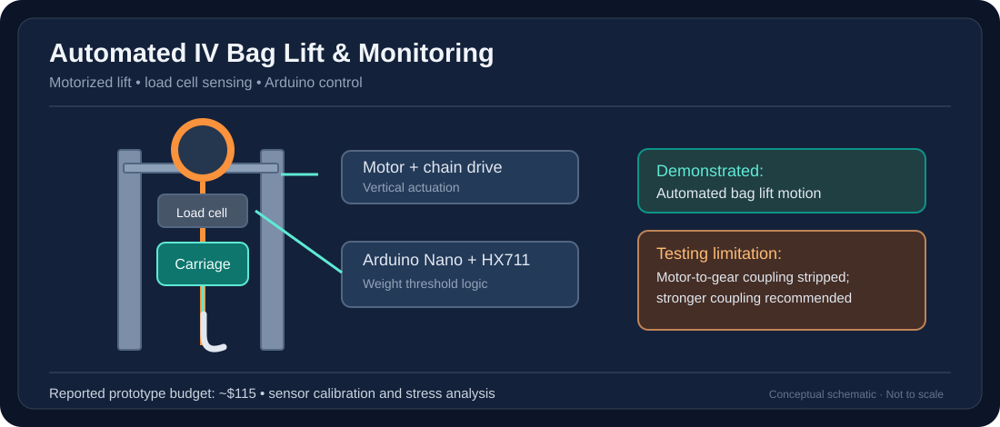

# Automated IV Bag Lift and Monitoring System

> Diagram is an original simplified illustration of the documented system; it is not a CAD export or validated engineering drawing.

**Focus:** Mechatronics · Arduino · Sensors · CAD · FEA

## My contributions and team credit
- **My contributions:** Developed the project's programming and all electronics, including sensor and motor-control integration.
- **Team work:** Mechanical design, prototyping and testing were collaborative. The final report credits Ian Bolinger, Preston Daily, Andy Zheng and Jack Shanahan alongside Ethan Pierce.

## Objective
Develop a low-cost motorized IV bag lift that detects bag weight and adjusts bag height automatically to reduce repetitive reaching and bending. This is an academic proof-of-concept, **not a clinically approved device**.

## Engineering work
- Compared concept alternatives using a weighted selection matrix.
- Designed a guided carriage, mounting hook, track and mechanical lifting system in SolidWorks.
- Integrated Arduino Nano control, an HX711 load-cell amplifier, stepper motor, switches, and alarm components.
- Fabricated and assembled 3D-printed and conventional parts.
- Conducted calibration trials and structural load/stress analysis.

## Reported results
- Estimated bill of materials: **$115.45**, below the $150 design budget.
- Demonstrated automated lifting and lowering in prototype testing.
- Test summary recorded approximately **5% measurement error** and mechanical instability above **8 kg**.
- Testing exposed a stripped D-shaped motor-to-gear connection. The report recommends a stronger coupling, limit switches, and reduced track friction.

## Technologies
`SolidWorks` `Arduino/C++` `HX711` `Stepper Motors` `3D Printing` `FEA`

**Documentation:** Detailed source report and Arduino code are available in the project archive; full team-authored documents are withheld here pending permission review.

[← Back to portfolio](../../README.md)
