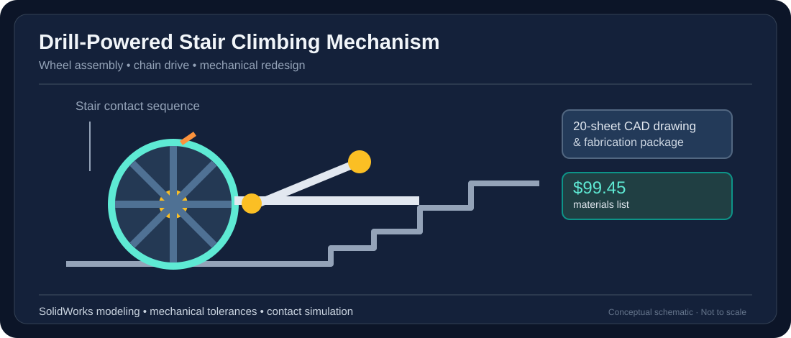

# Drill-Powered Stair-Climbing Mechanism

> Diagram is an original simplified illustration of the documented system; it is not a CAD export or validated engineering drawing.

**Focus:** SolidWorks · Mechanical Design · CAD Drawings · Design for Manufacturing

## Objective
Improve an existing cordless-drill-powered stair climber through better retracting climbing fingers, mechanical fit, rotational support, mass, storage and assembly practicality.

## Engineering work
- Modeled components and assembly geometry in SolidWorks.
- Developed a **20-sheet drawing package** with dimensions, tolerances, material selections, and manufacturing guidance.
- Investigated chain-and-sprocket motion, bearings, rotating wheels, support rails and climbing finger geometry.
- Prepared simulation images illustrating slope and stair contact configurations.
- Compiled a priced bill of materials cross-referenced to part identifiers.

## Reported results
- **$99.45 materials list**, meeting the $100 project constraint.
- Completed a CAD drawing package and documented contact/motion simulation.
- The provided documents do not establish independently verified climb speed, load capacity, or final assembled mass.

## Project demonstration
[Watch the stair-climber video on YouTube](https://youtu.be/po6vs3vmDWY?feature=shared).

## Technologies
`SolidWorks` `CAD` `Assembly Design` `Engineering Drawings` `BOM` `Motion Study`

[← Back to portfolio](../../README.md)
