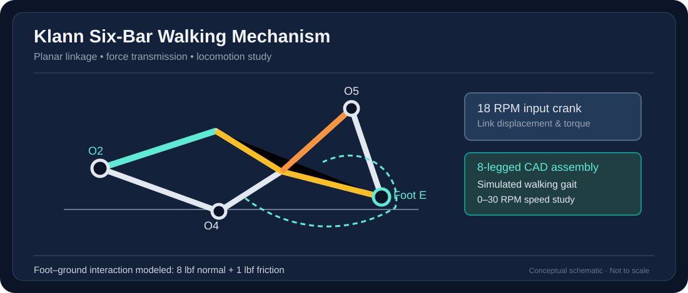

# Klann Six-Bar Walking Robot

> Diagram is an original simplified illustration of the documented system; it is not a CAD export or validated engineering drawing.

**Focus:** Robotics · Kinematics · Rigid-Body Dynamics · SolidWorks Simulation

## Objective
Analyze the walking trajectory, force transmission and input torque of a Klann six-bar linkage, then develop a simulated eight-legged walking robot.

## Engineering work
- Modeled the six-bar linkage and eight-legged walking assembly in SolidWorks.
- Developed free-body diagrams and force/moment balances for moving links.
- Evaluated foot-point displacement, stance and swing motion, and average forward velocity.
- Compared motor torque for unloaded and foot-ground-contact cases.
- Used **18 RPM clockwise input** and modeled **8 lbf normal** and **1 lbf horizontal friction** forces during stance.

## Reported results
- The linkage produced a nearly horizontal stance path and raised return stroke.
- Forward velocity increased approximately linearly with crank speed in the investigated **0–30 RPM** range.
- Contact loads substantially increased required drive torque.
- Fixed foot trajectory and intermittent ground contact were identified as stability limitations.

## Technologies
`SolidWorks` `Kinematics` `Dynamics` `Torque Analysis` `Motion Simulation`

**Media:** A robot animation and full technical report were supplied for this project; these team-created materials can be added following a sharing-permissions review.

[← Back to portfolio](../../README.md)
