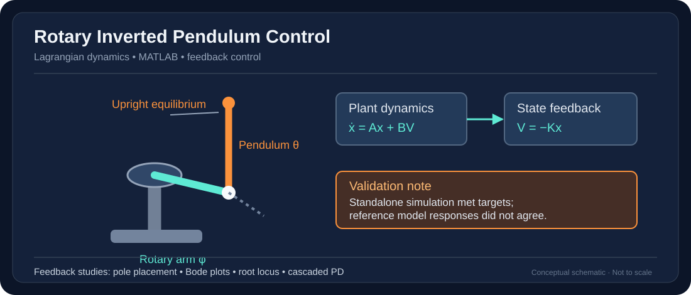

# Rotary Inverted Pendulum — Modeling and Feedback Control

> Diagram is an original simplified illustration of the documented system; it is not a CAD export or validated engineering drawing.

**Focus:** MATLAB · Dynamic Systems · Lagrangian Mechanics · Feedback Control

## Objective
Model the coupled motion of a Quanser QUBE rotary inverted pendulum (Furuta pendulum), and investigate stabilization of its unstable upright equilibrium.

## Engineering work
- Derived nonlinear equations using Lagrange's method, including gravity, inertia, electromechanical motor behavior and damping.
- Simulated the nonlinear plant in MATLAB.
- Linearized about the upright equilibrium and developed transfer-function/state-space representations.
- Analyzed eigenvalues, step responses, Bode frequency responses and sinusoidal inputs.
- Designed a full-state feedback controller using pole placement and explored cascaded PD control with root-locus tuning.
- Compared predictions against the supplied `run_Quanser_cube.p` reference simulation.

## Reported results and limitations
- In the team's standalone simulation, feedback control achieved approximately **0.5 s settling time** and **less than 5% overshoot** without exceeding motor voltage limits.
- **Reference-model responses did not match the standalone prediction.** The reported objectives must therefore not be represented as verified hardware performance.
- Energy-based swing-up was discussed as a possible future extension, rather than a demonstrated completed capability.

## Technologies
`MATLAB` `State-Space` `Transfer Functions` `Pole Placement` `Bode Plots` `Root Locus` `PD Control`

[← Back to portfolio](../../README.md)
